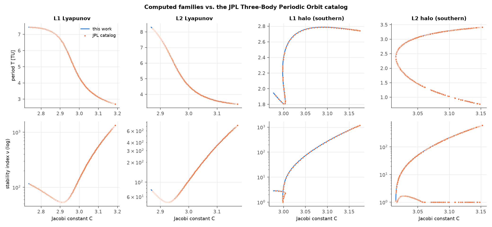
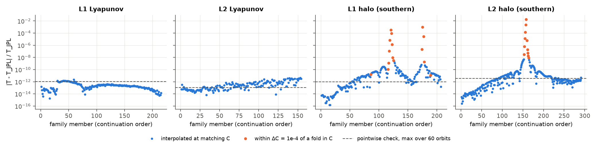
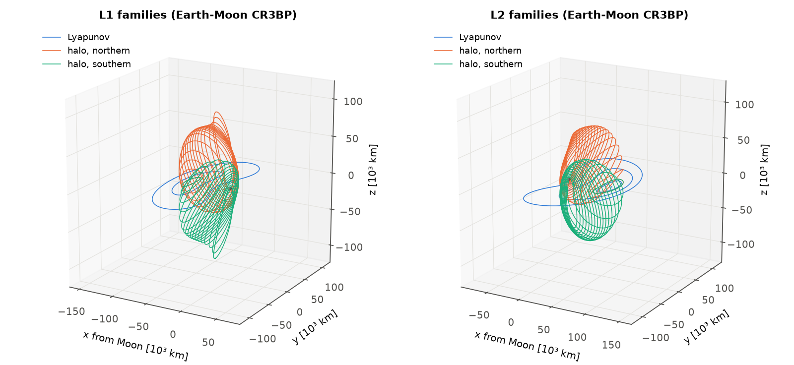
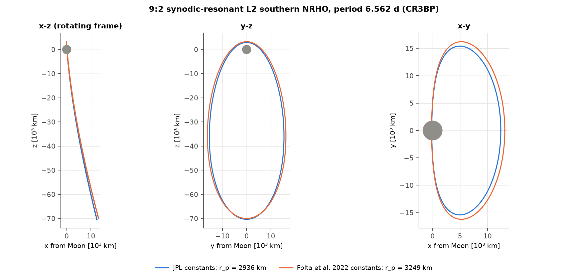
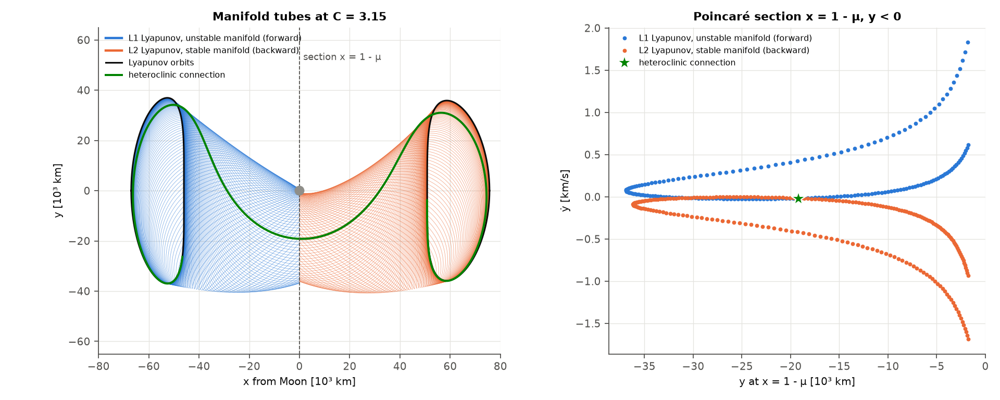

# Cislunar Periodic Orbits & Invariant Manifolds

Periodic orbits and their stable and unstable manifolds in the Earth-Moon circular restricted three-body problem (CR3BP), computed from first principles and checked against NASA JPL's Three-Body Periodic Orbit catalog. The toolkit computes the L1 and L2 Lyapunov families, the L1 and L2 halo families (northern and southern) through the near-rectilinear halo orbit (NRHO) region, the 9:2 lunar-synodic-resonant NRHO planned for the Gateway, and the invariant manifolds of Lyapunov orbits, including one L1-to-L2 heteroclinic connection.

*Badr Elsayed. Python 3.11+ / NumPy / SciPy; 54 automated tests in CI. Every number below is generated by the scripts into [RESULTS.md](RESULTS.md).*

**[Interactive 3D viewer](https://badrelsayednyu.github.io/cislunar-orbits/)**: rotate the computed families and the 9:2 NRHO in your browser.



## Motivation

Trajectory design in multi-body systems is built out of a small set of dynamical structures: periodic orbits, which are places a spacecraft can stay, and their stable and unstable manifolds, which are the natural highways into and out of them. Missions such as ARTEMIS, CAPSTONE and the Gateway use exactly these objects. This project builds those building blocks for the Earth-Moon system from the equations of motion up, with every piece validated against an independent reference before it is used for the next one.

## The CR3BP in brief

Two primaries (Earth, mass 1 − μ, and Moon, mass μ) move on circular orbits about their barycenter, and a spacecraft of negligible mass moves under their gravity. In a frame rotating with the primaries, using the Earth-Moon distance and the inverse mean motion as length and time units,

$$
\ddot x - 2\dot y = \frac{\partial U}{\partial x},\qquad
\ddot y + 2\dot x = \frac{\partial U}{\partial y},\qquad
\ddot z = \frac{\partial U}{\partial z},\qquad
U = \tfrac12(x^2+y^2) + \frac{1-\mu}{r_1} + \frac{\mu}{r_2}.
$$

The system has one integral, the Jacobi constant $C = 2U - v^2$, and five equilibria (L1-L5). Near L1 and L2 there are families of periodic orbits. The planar Lyapunov orbits bifurcate into the 3D halo orbits, which then stretch toward the Moon into the NRHOs.

All constants come from the JPL API response itself (μ = 0.01215058560962404, LU = 389,703.26 km, TU = 382,981.29 s), so every catalog comparison uses the same model as the catalog.

## Methods

| Piece | Method | Check before use |
|---|---|---|
| Dynamics | Equations of motion, analytic pseudo-potential Hessian, 42-state variational equations for the state transition matrix (STM); `solve_ivp` DOP853, rtol = atol = 1e-12 (1e-13 near the Moon) | Jacobi drift 4.5e-11 over 10 halo periods (139 d); STM vs. central differences with h² convergence; time-reversal symmetry |
| Libration points | Newton's method on the collinear quintics; L4/L5 in closed form | ∇U < 4e-16; within 4.2e-15 LU of JPL's tabulated points |
| Periodic orbits | Single shooting on the half period: free variables (x₀, z₀, ẏ₀, T/2), constraints y = ẋ = ż = 0 at T/2 | Full-period closure ‖X(T) − X₀‖ < 1e-10 for every stored orbit |
| Families | Natural-parameter continuation, switching to pseudo-arclength if steps fail. The halo families use 10 natural steps off the bifurcation (fixing whichever of x₀, z₀, ẏ₀ changes fastest along the family) then pseudo-arclength through the NRHOs | Members compared with JPL |
| Stability | Monodromy eigenvalues; JPL stability index ν = ½(\|λ_max\| + 1/\|λ_max\|); Broucke parameters for the out-of-plane pair | The definition reproduces JPL's ν from JPL's own initial conditions; reciprocal-pair defect ≤ 1.6e-8 |
| Bifurcations | Brent's method on s_z − 2, where s_z = trace of the (z, ż) block of the planar monodromy | Bifurcating orbit's period equals the end of JPL's halo family |
| 9:2 NRHO | Southern L2 halo with the period as the fixed variable, rtol = atol = 1e-13 | Two unit conventions; published values |
| Manifolds | Eigenvectors of the monodromy matrix mapped by the STM, 50 km step, propagated to the x = 1 − μ section; arcs stop at the lunar surface | Jacobi drift; step-size study; heteroclinic match |

The JPL catalog is sorted by Jacobi constant, not by position along a family, and C turns back on itself along the halo families, so the same C can belong to two different orbits. Each computed orbit is therefore compared in two ways: by interpolating the catalog at its Jacobi constant within the matching branch, and pointwise, by correcting our orbit to the location of a catalog orbit (one coordinate fixed, no interpolation).

## Validation

| Check | Result |
|---|---|
| Periods vs. JPL, pointwise | **360 catalog orbits in 6 families, max relative error 3.7e-12**, Jacobi constant within 2.1e-12, no failed corrections |
| Periods vs. JPL, interpolated at matching C | 1359 comparisons, median relative error ≤ 6.4e-12 in every family (outliers only at folds in C; see below) |
| Stability index vs. JPL, pointwise | ≤ 2.4e-9 relative for the halo families, ≤ 3.2e-7 for L1 Lyapunov, ≤ 9.5e-4 for L2 Lyapunov (limited by the catalog; see below) |
| Halo bifurcation from the Lyapunov family | L1: C = 3.174352, T = 2.742994 TU (JPL halo family ends at 2.743001); L2: C = 3.152119, T = 3.415531 TU (JPL: 3.415531) |
| Folta et al. (2022) Table 3, six Lyapunov/halo orbits | Jacobi constant within 3.8e-7 and state within 9.9e-7 of the published values (published to 6 decimals) |
| Manifolds | Jacobi drift ≤ 5.0e-11 on every trajectory; section curves unchanged (≤ 6.3 km, p95) for step sizes 5-500 km |



**Where the comparison is weakest, and why.** Interpolating the catalog in C fails near the folds where C turns back along a family, because dT/dC is unbounded there (orange points above; max interpolated period error 1.9e-2 in the L2 halo family). The pointwise check covers the same orbits and agrees to 3.7e-12, so this is an artifact of the comparison method, not of the orbits. The largest stability-index differences are in the biggest L2 Lyapunov orbits, which pass inside the Moon (845-1259 km from its centre). There the catalog's own initial conditions do not close (2.0e-8 to 2.4e-7 over one period) and its tabulated ν differs by up to 1.3e-3 from ν recomputed from those same initial conditions, so our 1.6e-4 disagreement is within the catalog's own uncertainty.



## The 9:2 NRHO

The Gateway's orbit is the L2 southern NRHO whose period is 2/9 of the lunar synodic month, (2/9) × 29.530589 d = 6.5624 d. To pick out that member, the period in days has to be converted to nondimensional time, and that conversion depends on the characteristic time unit. JPL's catalog uses LU = 389,703 km (TU = 382,981 s); most of the NRHO literature uses LU = 384,400 km (TU = 375,190 s, Folta et al. 2022 Table 2). The two give different family members:

| CR3BP 9:2 NRHO | JPL constants | Folta et al. (2022) constants |
|---|---|---|
| Period | 6.5624 d (1.480457 TU) | 6.5624 d (1.511199 TU) |
| Perilune radius (altitude) | 2936.1 km (1199.0 km) | 3249.3 km (1512.2 km) |
| Apolune radius | 71,407 km | 71,222 km |
| Jacobi constant | 3.048871 | 3.046494 |
| Stability index | 1.256 | 1.323 |

| Published value | Model | Value | Ours (Folta constants) |
|---|---|---|---|
| Zimovan, Howell & Davis (2017) | CR3BP, read from a figure ("about") | ~3150 km perilune | 3249 km (+99 km) |
| Lee (2019), Gateway reference trajectory | Ephemeris, 15 years | 3196-3557 km, mean 3366 km | 3249 km (inside the range) |

Changing only the characteristic quantities moves the 9:2 perilune by 313 km. That difference is larger than our offset from either published value, so the unit system has to be stated with any CR3BP NRHO number. The ephemeris values are not expected to equal CR3BP values; Lee's trajectory needs small velocity adjustments every revolution to stay on the NRHO. No published CR3BP apolune, Jacobi constant or stability index for the 9:2 NRHO was found in these sources, so those values are reported without comparison.



## Invariant manifolds

At C = 3.15 the unstable manifold of the L1 Lyapunov orbit (the half that enters the Moon region) and the stable manifold of the L2 Lyapunov orbit (the half that arrives from it) are cut at the section x = 1 − μ. Where their section curves cross, a trajectory leaves the L1 orbit and arrives at the L2 orbit with no maneuver: a heteroclinic connection. One was refined to a position mismatch of 2.8e-9 km and a velocity mismatch of 0.013 mm/s at the section (11.1 d from the L1 orbit to the section, 14.5 d from the section to the L2 orbit). 108 of the 300 L1 unstable-manifold trajectories and 67 of the 300 L2 stable-manifold trajectories reach the lunar surface before the section and are stopped there.

The 50 km step is small enough that the linear (eigenvector) approximation holds (the Jacobi offset it introduces is at most 8.6e-8, and second order in the step) and large enough that trajectories leave the orbit within about a period. Section curves for 5, 10, 25, 100, 200 and 500 km steps agree with the 50 km curve to ≤ 6.3 km (95th percentile), about the spacing of the sampled curve.



## Interactive viewer

**Online: [https://badrelsayednyu.github.io/cislunar-orbits/](https://badrelsayednyu.github.io/cislunar-orbits/)**. A static page (GitHub Pages, generated by `scripts/make_viewer.py`) showing 24 members of each family and the 9:2 NRHO under both unit conventions; hover over an orbit for its period, Jacobi constant, stability index and apses.

The full Streamlit app runs locally:

```bash
streamlit run app/streamlit_app.py
```

Pick a family and a member to see the orbit in 3D, its period, Jacobi constant, stability index, apses, and the interpolated JPL values at the same C; optionally compute its manifolds. A second tab shows the 9:2 NRHO under both unit conventions.

## Reproducing the results

```bash
python -m venv .venv && source .venv/bin/activate
pip install -e ".[dev,app]"
pytest                                   # 54 tests, ~10 s, no network access
python scripts/fetch_jpl.py              # only to refresh the cached catalog (data/jpl/)
python scripts/run_families.py           # Lyapunov + halo families and JPL comparisons (~2 min)
python scripts/run_nrho.py               # 9:2 / 4:1 / 3:1 NRHOs and the Folta Table 3 check
python scripts/run_manifolds.py          # manifolds, step-size study, heteroclinic (~3 min)
python scripts/make_figures.py           # docs/figures/
python scripts/make_results.py           # RESULTS.md
python scripts/make_viewer.py            # docs/index.html (online viewer)
```

```
cr3bp/
  dynamics.py       equations of motion, Jacobi constant, STM, propagation, y = 0 events, apses
  lagrange.py       L1-L5
  correction.py     single-shooting differential correction, extra constraints
  continuation.py   natural-parameter / pseudo-arclength continuation, bifurcation finder
  stability.py      monodromy, stability index, Broucke parameters
  manifolds.py      eigendirections, manifold seeds, propagation to a section
  jpl.py            cached-catalog loader, interpolated and pointwise comparisons
  units.py          nondimensional <-> km, days (JPL constants)
scripts/            fetch_jpl, run_families, run_nrho, run_manifolds, make_figures, make_results
data/jpl/           raw JPL API responses with fetch time (2026-11-21)
data/published/     transcribed published reference values with sources
data/results/       computed families and summaries (inputs to RESULTS.md, figures, app)
tests/              pytest suite
app/                Streamlit viewer
```

## Decisions and limitations

- **CR3BP only.** No lunar eccentricity, solar gravity, ephemeris model, solar radiation pressure or non-spherical gravity. NRHO values are CR3BP values and differ from ephemeris trajectories.
- **No station-keeping or navigation.** Orbits are ideal periodic solutions; real NRHOs need orbit maintenance.
- **Not flight-qualified.** This is a validated research and learning tool, not mission software.
- **Family extent.** Halo families stop where the perilune reaches the lunar surface (1737.1 km). The JPL catalog continues past that (L2 halos to a perilune of 29 km, L1 halos to C = 0.195, all of which pass inside the Moon). Lyapunov families cover the catalog's Jacobi range; the largest L2 Lyapunov orbits there pass inside the Moon (perilune down to 718 km from its centre) and are kept only for the comparison.
- **Southern branches** are the northern branches mirrored (z → −z), each mirrored orbit re-integrated and compared with JPL's southern catalog.
- **Axial families** branch at the second s_z = 2 crossing on each Lyapunov family; those points are reported but the axial families are not computed.
- **Published 9:2 values** come from a figure (Zimovan et al., "about 3150 km") and from an ephemeris trajectory (Lee); neither is an exact CR3BP reference, so agreement is reported in km, not claimed as a precise match.
- **Tolerances**: rtol = atol = 1e-12 by default; 1e-13 for halo orbits within 0.05 LU of the Moon, for any orbit whose closure exceeded 5e-11, and for NRHO solutions.

## References

- NASA JPL Solar System Dynamics, Three-Body Periodic Orbits API, https://ssd-api.jpl.nasa.gov/doc/periodic_orbits.html (catalog fetched 2026-11-21).
- D. Folta, N. Bosanac, I. Elliott, L. Mann, R. Mesarch, J. Rosales, *Astrodynamics Convention and Modeling Reference for Lunar, Cislunar, and Libration Point Orbits*, NASA/TP-20220014814, v1.1, 2022.
- E. M. Zimovan, K. C. Howell, D. C. Davis, "Near Rectilinear Halo Orbits and Their Application in Cis-Lunar Space," 3rd IAA Conference on Dynamics and Control of Space Systems, IAA-AAS-DyCoSS3-125, 2017.
- D. E. Lee, "White Paper: Gateway Destination Orbit Model: A Continuous 15 Year NRHO Reference Trajectory," NASA, NTRS 20190030294, 2019.
- V. Szebehely, *Theory of Orbits: The Restricted Problem of Three Bodies*, Academic Press, 1967.
- W. S. Koon, M. W. Lo, J. E. Marsden, S. D. Ross, *Dynamical Systems, the Three-Body Problem and Space Mission Design*, 2011.
- K. C. Howell, "Three-dimensional, periodic, 'halo' orbits," *Celestial Mechanics* 32, 53-71 (1984).
- R. Broucke, "Stability of periodic orbits in the elliptic, restricted three-body problem," *AIAA Journal* 7, 1003-1009 (1969).
- E. L. Allgower, K. Georg, *Introduction to Numerical Continuation Methods*, SIAM, 2003.

## AI assistance

Claude Code (Anthropic) helped write and check the code, tests and documentation in this repository. The methods, validation criteria and comparisons were specified up front, every result was checked against an independent reference (the JPL catalog, published tables and figures, or analytic properties such as symplecticity and Jacobi conservation), and every number reported here is produced by the scripts.
